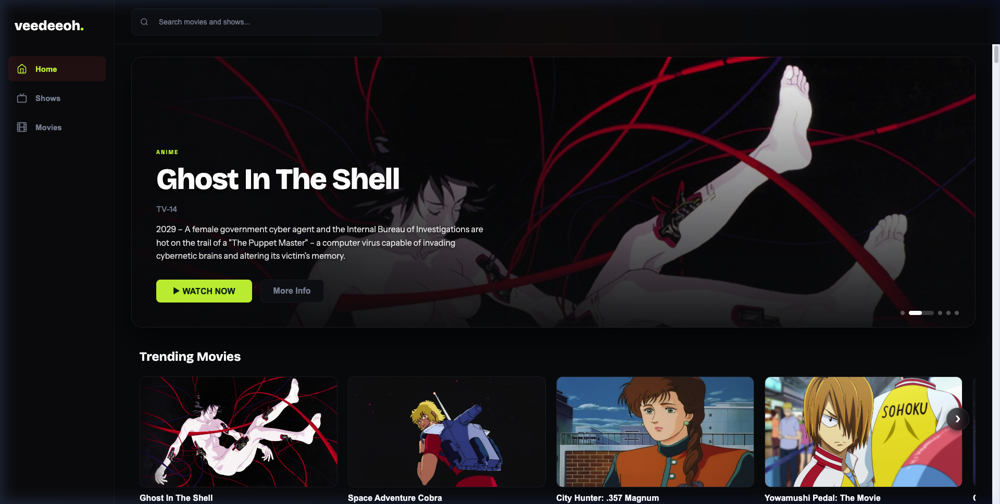
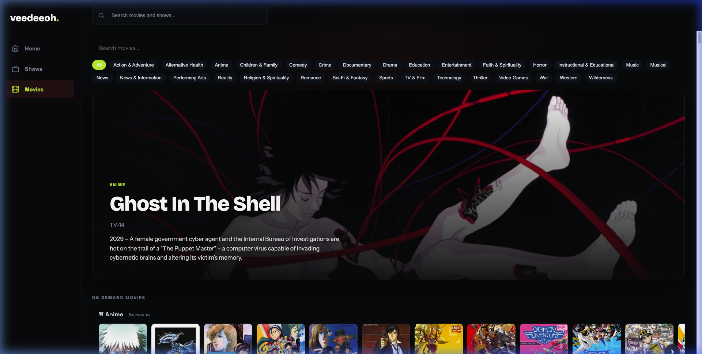
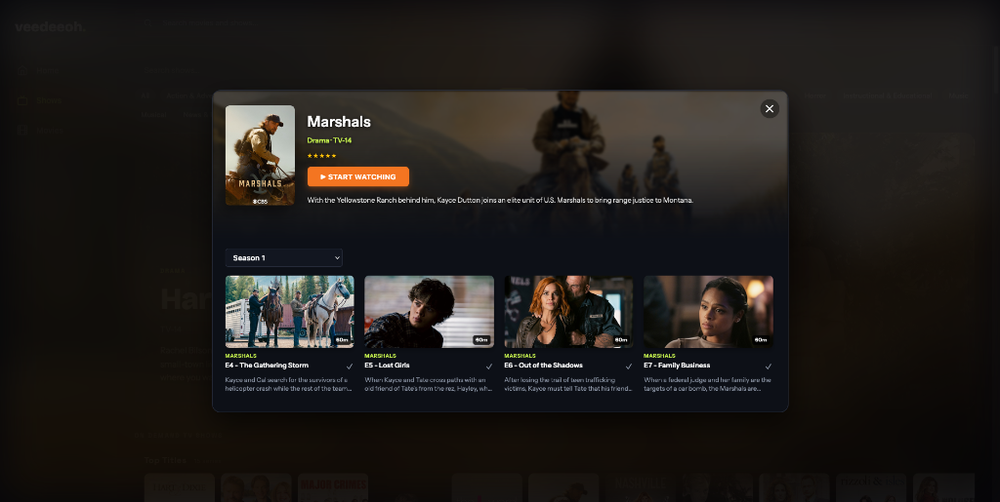
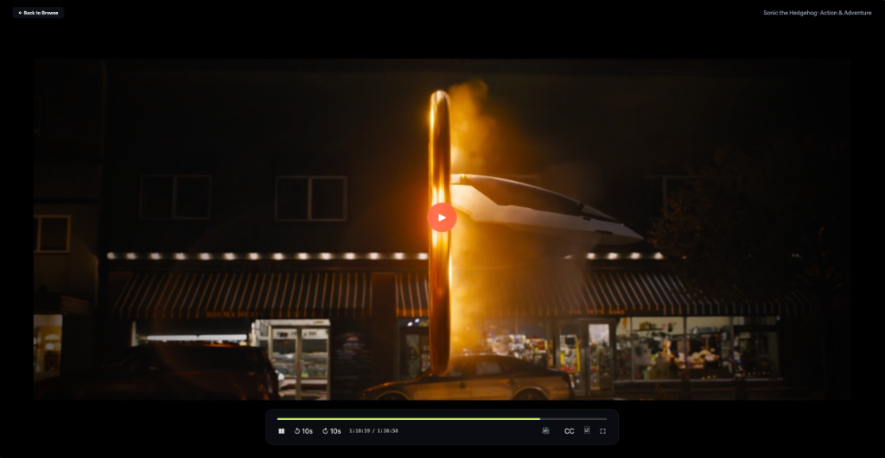

# veedeeoh.

[](https://github.com/ItsCodejac/veedeeoh/actions/workflows/ci.yml)
[](https://opensource.org/licenses/MIT)

A standalone movie and TV catalogue/player built with Hono, Vite and Docker. The self-hosted product runs without a Veedeeoh account, subscription, Supabase project or API keys. Streaming still needs Internet access and depends on provider availability in your region.

## Install with Docker Compose

```sh
git clone https://github.com/ItsCodejac/veedeeoh.git
cd veedeeoh
docker compose up -d --build
```

Open `http://localhost:8321` or `http://YOUR-SERVER-IP:8321` on your home network. Set `PORT` in `.env` to change the published port. Compose always builds the self-host product, even if cloud credentials exist in your environment. The image uses Node.js 24 LTS and the committed dependency locks.

The named `veedeeoh_data` volume survives container recreation. Existing Compose installations keep that volume; it is now mounted at `/data` rather than `/root/.local/share/tvlc`. Do not use `docker compose down -v` when updating: that removes the volume.

```sh
# Inspect startup and provider failures
docker compose logs --tail=100 veedeeoh
# Confirm the server is running
curl -f http://localhost:8321/api/health
```

This is a trusted home-network application with no server account gate. For access outside your home, use a private VPN or an authenticated reverse proxy with HTTPS.

## Install from source

Requires Node.js 24 LTS and npm. Run from the repository root:

```sh
npm ci --prefix frontend
npm ci --prefix backend
npm run build:selfhost
npm start --prefix backend
```

The build prints `building SELF-HOST`. It ignores cloud credentials and writes the website to `src/tvlc/static`. The backend serves that website and its API on port 8321. For development, run `npm run dev --prefix backend` and `npm run dev --prefix frontend` in separate terminals.

| Setting | Default | Purpose |
| --- | --- | --- |
| `PORT` | `8321` | Server port for source installs; published host port for Compose. |
| `VEEDEEOH_DATA_DIR` | Platform application-data directory | Optional source-install data location. Docker uses `/data`. |
| `PROXY_URL` | Same origin | Optional external proxy base for a Compose build. Source builds use frontend `VITE_PROXY_URL`. |

For source installs, export these variables in the server environment; the server does not automatically load `.env`. Compose reads the root `.env` itself. `VITE_SUPABASE_*` belongs to the separate cloud build and is not needed here.

## What is saved

- My List, watched status and exact resume positions are saved on this server, per local profile ID, in `library.json`.
- Existing `favorites.json` and `watched.json` are imported into Main Profile and left unchanged.
- Profile names, avatars, PINs and playback preferences remain browser-local. Two browsers do not automatically share their profile selections or profile definitions.
- Existing browser-local Continue Watching entries remain readable. Their next playback updates the server resume record.
- Catalogue data is cached in memory and can be rebuilt; it is not a persistent media download.

The source-install default is `~/.local/share/tvlc` on Linux, `~/Library/Application Support/tvlc` on macOS, or `%APPDATA%/tvlc` on Windows. `VEEDEEOH_DATA_DIR` overrides it.

Writes replace JSON files atomically and retain the previous snapshot as `.bak`. A failed save produces an error rather than claiming success. If a primary JSON file is corrupt, the server logs recovery from its backup; preserve the damaged file and backup while investigating. Unrecoverable corruption stops startup instead of silently presenting an empty library.

## Back up, restore and update

Stop the service before copying its data. Keep backups outside the container and retain the `.bak` files.

```sh
# Back up the entire server data directory
docker compose stop
docker compose cp veedeeoh:/data ./veedeeoh-backup
docker compose start

# Update after taking a backup
git pull --ff-only
docker compose up -d --build
```

Before restoring, back up the current folder separately, then:

```sh
docker compose stop
docker compose cp ./veedeeoh-backup/. veedeeoh:/data
docker compose start
```

For source installs, stop the Node process, copy the configured data directory, then restart. Back up browser settings separately if you need the local profile definitions and preferences.

## Verification

```sh
npm run test:selfhost
```

The regression suite checks local persistence and legacy migration, separate profile shelves, region selection, SPA routes, failed saves, backup recovery, HLS rewriting and byte-range seeking. CI also builds the actual Docker image and checks startup, navigation and persistence across a container restart. Tests use isolated data directories and controlled provider responses; they do not certify every title or region is playable.

## Cloud feature boundary

Watch parties, hosted account sync, billing and referrals belong to the cloud product. The self-host build hides those entry points and does not contact the hosted database. The same catalogue/player code is shared between both builds.

Content is indexed from public providers including Pluto TV, Tubi and Internet Archive. Availability and playback can change upstream.

## Interface



### Movies and shows


### Episode and series details


### In-page playback

